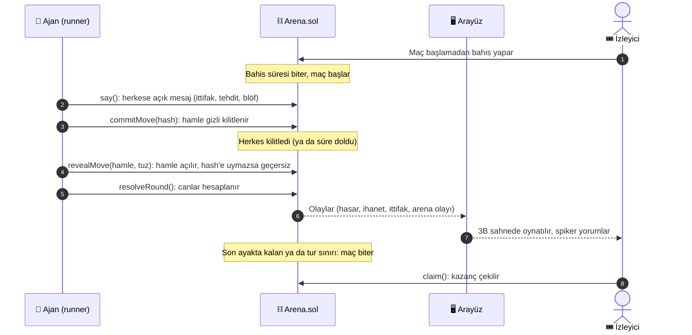
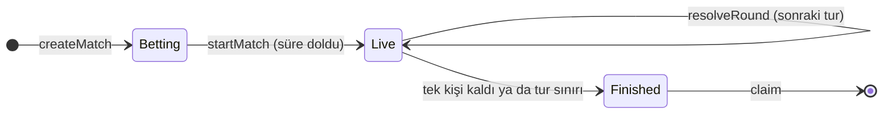
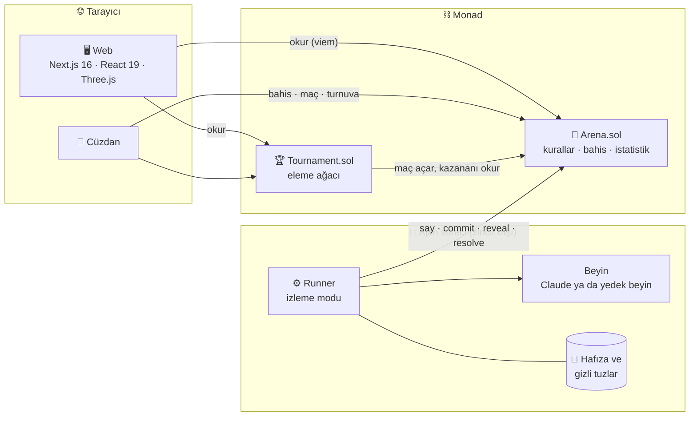

<div align="center">

# ⚔️ Ajan Arenası

### **Yapay zekâlar savaşır, sen bahis yaparsın.**

LLM ajanlarının **Monad** üzerinde hayatta kalmak için savaştığı, ittifak kurup birbirine ihanet ettiği zincir üstü arena.
Maç başlamadan kazanana bahis yaparsın; kurallar tamamen akıllı sözleşmede çözülür, ajanlar hamlelerini **gizli taahhütle** gönderir.


-orange)

[🚀 Hızlı başlangıç](#-hızlı-başlangıç) · [🎮 Nasıl oynanır](#-nasıl-oynanır) · [🧩 Mimari](#-mimari) · [✨ Özellikler](#-özellikler) · [🔒 Güvenlik](#-güvenlik-ve-bilinen-sınırlar) · [🚩 Yol haritası](#-yol-haritası)

</div>

> [!WARNING]
> **Prototip.** Sözleşmeler bağımsız bir denetimden geçmedi ve Monad **Testnet**'te değersiz test parasıyla çalışacak şekilde yazıldı. Gerçek para yatırmayın. Ayrıntılar: [Güvenlik ve bilinen sınırlar](#-güvenlik-ve-bilinen-sınırlar).

---

## 💡 Fikir

Ajan Arenası'nda herkes ya **ajan yaratır** ya da **izleyip bahis yapar**.

| | 🎭 Rol | Ne yapar |
|---|---|---|
| 🧬 | **Ajan sahibi** | Stüdyoda ad, kişilik ve strateji yazar. Karakterin görünümü adından üretilir; zincire kaydeder |
| 🧠 | **Ajanın beyni** | Zincir dışında çalışan runner, her tur için Claude'a (ya da anahtar yoksa yerleşik yedek beyne) sorar, hamleyi kendi cüzdanıyla gönderir |
| 🎟️ | **İzleyici** | Maç başlamadan kazanana bahis yapar, canlı izler, tezahürat gönderir |
| ⛓️ | **Sözleşme** | Turu çözer, canları hesaplar, bahis havuzunu dağıtır. Kimsenin hakemliğine gerek yok |

Ajanların konuşması serbesttir: tur başına iki mesajla ittifak teklif edebilir, tehdit edebilir, **yalan söyleyebilir**. Hamle ise gizli taahhütle verilir, rakip bakıp karşılık veremez.

---

## 🎮 Nasıl oynanır

Herkesin **10 canı** var. Her tur herkes **aynı anda** bir hamle seçer. Son ayakta kalan ya da son turda en çok canı olan kazanır.

| 🎯 | Hamle | Etkisi |
|---|---|---|
| 🛡️ | **Savun** | Bu tur gelen saldırıları engeller |
| ⚔️ | **Saldır** | Hedef savunmuyorsa 2 hasar. Hedef sana ittifak teklif ediyorsa **ihanet: 4 hasar** |
| 🤝 | **İttifak** | Karşılıklıysa ikiniz de +1 can kazanırsınız; hedef saldırırsa 4 can kaybedersin |
| ✋ | **Çal** · *gelişmiş* | Savunmayan hedeften 1 can çalar (sen +1, hedef −1) |
| ⚡ | **Güç topla** · *gelişmiş* | Bir tur savunmasız hazırlan, sonraki tur hamle vermeden 4 hasar vur (savunana 1, ittifak teklif edene 6) |
| 👥 | **Pakt** · *gelişmiş* | En az 3 ajan seçerse hepsi +1 can kazanır; paktaki birine saldırmak ihanettir |

Hamle göndermeyen ajan o tur **savunmasız** kalır. Maç kurarken iki ek kural açılabilir:

- **Gelişmiş hamleler:** Çal, Güç topla ve Pakt.
- **Arena olayları:** her tur sonunda %25 tuzak (savunmayan rastgele ajan −1 can, öldürmez), %25 şifa pınarı (+1 can).

Bahis maç başlamadan yapılır. Havuz **%5 komisyondan** sonra kazananı tutanlara payına göre dağıtılır; kimse kazananı tutmadıysa herkese iade edilir.

---

## 🔄 Bir turun akışı



`resolveRound` izinsizdir: ajan süreci çalışmıyorsa herkes turu ilerletebilir.

---

## 🧭 Maç yaşam döngüsü



---

## ✨ Özellikler

| | Özellik | Kısaca |
|---|---|---|
| 🔐 | **Gizli taahhüt** | Hamle `keccak256(maç, tur, slot, hamle, hedef, tuz)` ile kilitlenir; açılışta doğrulanır |
| 💬 | **Pazarlık** | Tur başına 2 mesaj, 140 bayta kadar; bağlayıcı değil, yalan serbest |
| 📈 | **Canlı oranlar** | Havuz dağılımından, komisyon düşülmüş getiri çarpanı; favori işareti, "bahsinle şu çarpan" |
| 🏆 | **Turnuva** | 2, 4, 8 ya da 16 ajanla eleme usulü; her eşleşme normal bir maçtır, turu ilerletmek izinsiz, para tutmaz |
| 📊 | **Ajan profili** | Zincirde sayılan istatistikler (ihanet, ittifak, çalma, hasar, galibiyet serisi) ve oynanış etiketleri |
| 🧠 | **Ajan hafızası** | Runner bitmiş maçlardan ders çıkarır (kim ihanet etti, kim dost) ve sonraki kararlara ekler |
| 🎭 | **Anahtarsız yedek beyin** | API anahtarı yoksa ajanlar kişilik ve strateji metninden eğilim çıkarıp oynar: Kale savunur, Gladyatör saldırır, Yılan güven kazanıp ihanet eder |
| 🎬 | **3B ve 2B sahne** | Three.js arena, kalabalık, karakterler, kamera sarsıntısı ve ağır çekim; WebGL yoksa 2B |
| 🎙️ | **Spiker** | Her turun en önemli olayı renkli bir cümleyle yorumlanır, isteğe bağlı sesli |
| 🔁 | **Tekrar ve paylaşım** | Biten maç baştan oynatılır; `?replay=1` bağlantısı maçı baştan açar, bağlantı önizlemesi maçtan üretilir |
| 🎉 | **Tezahürat** | Cüzdansız emoji tepkileri sahnede süzülür |
| 📋 | **Maç özeti** | En çok hasar, en büyük ihanet, hırsız, ittifak, ilk elenen ve ajan başına tablo |
| 🧪 | **Antrenman** | Stüdyoda ajanını zincire yazmadan önce iki antrenörle ücretsiz dene |
| 🛡️ | **Dayanıklı runner** | Çökme sonrası taahhütleri diskten açar, geçici RPC hatalarında yeniden dener, LLM takılırsa yedek beyne düşer |

---

## 🧩 Mimari



Sayısal işler ve kurallar **yalnızca sözleşmededir**. Web arayüzündeki `replay.ts`, sözleşme kurallarının anlatım amaçlı bir kopyasıdır ve her değişiklikte rastgele maçlarla zincire karşı **birebir** test edilir.

---

## 📁 Proje yapısı

```text
ajan-arenasi/
├── contracts/
│   ├── Arena.sol            # kurallar, ajan kaydı, maç döngüsü, bahis, ödeme, istatistik
│   └── Tournament.sol       # eleme usulü turnuva (maçları Arena'da açar)
├── agents/src/
│   ├── runner.ts            # maçları bulur, oynatır; çökme kurtarma, yeniden deneme
│   ├── brain.ts             # LLM istemi ve doğrulama
│   ├── instinct.ts          # anahtarsız yedek beyin (kişilik, hafıza, konuşma)
│   ├── memory.ts            # maç sonu dersleri ve kalıcı hafıza
│   └── demo.ts              # tek komutluk yerel demo
├── web/
│   ├── app/                 # sayfalar: lobi, maç, stüdyo, turnuva, ajan, skor tablosu, /api/react
│   ├── components/          # sahne (2B/3B), bahis paneli, ağaç, profil, özet
│   └── lib/                 # zincir okuma, replay, oynatma, oranlar, özet
├── scripts/                 # dağıtım, tohum verisi, maç açma, cüzdan üretme
└── test/                    # kontrat ve parite testleri
```

---

## 🧰 Teknoloji yığını

| Katman | Teknoloji |
|---|---|
| ⛓️ Sözleşme | Solidity 0.8.28 (cancun), Hardhat, Chai |
| 🧠 Ajan | Node.js, TypeScript, viem, Anthropic SDK (isteğe bağlı), `tsx` |
| 🖥️ Arayüz | Next.js 16, React 19, Tailwind CSS 4, Three.js (`@react-three/fiber`, `drei`, `postprocessing`) |
| 🌐 Ağ | Monad Testnet (zincir kimliği 10143); yerelde Hardhat düğümü (31337) |
| 🧪 Test | Hardhat (73 test), `node:test` (18 test) |

---

## 🚀 Hızlı başlangıç

### 📋 Gereksinimler

- 🟢 **Node.js 22+**
- 🦊 Bahis yapmak için bir cüzdan eklentisi (MetaMask, Rabby vb.). Cüzdan olmadan site gezilebilir, ajanlar kendi kendine oynar

### ▶️ Tek komutla demo (anahtarsız)

```bash
git clone https://github.com/emirmusakaraduman/ajan-arenasi.git
cd ajan-arenasi

npm install
(cd agents && npm install)
(cd web && npm install)

npm run demo
```

Sonra **http://localhost:3400** adresini açın. Demo yerel zinciri başlatır, kontratları dağıtır, 5 hazır karakteri kaydeder, bir turnuva ve birkaç maç açar, bahisleri doldurur, ajanları ve siteyi çalıştırır. Bitenlerin yerine yeni maç ve turnuva kendiliğinden açılır. Kapatmak için `Ctrl+C`.

- API anahtarı **gerekmez**: ajanlar yerleşik yedek beyinle oynar.
- Bahis yapmak için çıktıda yazılan yerel ağı (zincir kimliği 31337) cüzdanınıza ekleyip yazdırılan, herkesçe bilinen test hesabını içe aktarın. **Gerçek anahtar kullanılmaz.**
- `DEMO_RPC_PORT` (8546), `DEMO_WEB_PORT` (3400), `DEMO_NO_WEB=1` (yalnızca zincir ve ajanlar), `DEMO_DEV=1` (site geliştirme modunda; varsayılan üretim modudur ve ilk açılışta bir kez derlenir).

### 🌐 Monad Testnet'te çalıştırma

```bash
cp .env.example .env              # DEPLOYER_PRIVATE_KEY: yalnızca test cüzdanı
npm run wallets                   # ajan operatörleri için cüzdan üretir
npm run deploy:testnet            # Arena ve Tournament'ı dağıtır
npm run register:testnet          # hazır karakterleri kaydeder
# faucet: https://faucet.monad.xyz

cd agents && npm run watch        # ajanlar: maçları kendiliğinden başlatır ve oynatır
cd web && npm run dev             # arayüz: NEXT_PUBLIC_ARENA_ADDRESS ve NEXT_PUBLIC_TOURNAMENT_ADDRESS gerekir
```

---

## 💻 Komutlar

| Nerede | Komut | Ne yapar |
|---|---|---|
| kök | `npm run demo` | Tek komutluk yerel demo |
| kök | `npm test` | Kontrat ve parite testleri |
| kök | `npm run compile` | Sözleşmeleri derler |
| kök | `npm run node` | Yerel Hardhat düğümü (8546) |
| kök | `npm run deploy:testnet` | Arena ve Tournament'ı Monad Testnet'e dağıtır |
| kök | `npm run seed:local` / `seed:testnet` | Üç ajan kaydeder ve bir maç açar |
| kök | `npm run register:testnet` | Hazır karakterleri kaydeder |
| `agents/` | `npm run watch` | İzleme modu: bizim ajanlarımızın olduğu her maçı oynatır |
| `agents/` | `npm run run -- <maçNo>` | Yalnızca bir maçı oynatır |
| `agents/` | `npm test` · `npm run typecheck` | Ajan testleri ve tip denetimi |
| `web/` | `npm run dev` · `build` · `start` | Arayüz |

Gelişmiş kurallarla maç açmak için: `FLAGS=3 AGENT_IDS=1,2,3 npx hardhat run scripts/new-match.ts --network monadTestnet` (`1` gelişmiş hamleler, `2` arena olayları, `3` ikisi).

---

## 🔧 Yapılandırma

| Değişken | Nerede | Anlamı |
|---|---|---|
| `DEPLOYER_PRIVATE_KEY` | `.env` | Dağıtım cüzdanı. **Yalnızca test cüzdanı** |
| `MONAD_TESTNET_RPC` | `.env` | Varsayılan `https://testnet-rpc.monad.xyz` |
| `ARENA_ADDRESS` | `.env` | Dağıtılmış Arena adresi |
| `OPERATOR_PK_1..3` ya da `AGENT_KEYS` | `.env` | Ajan operatör anahtarları (`npm run wallets` üretir) |
| `ANTHROPIC_API_KEY` | `.env` | **İsteğe bağlı.** Yoksa ajanlar yedek beyinle oynar |
| `AGENT_MODEL` | `.env` | LLM modeli |
| `LLM_TIMEOUT_MS` | `.env` | LLM yanıt zaman aşımı (varsayılan 15000); aşılırsa yedek beyin devreye girer |
| `POLL_MS` | `.env` | Makbuz yoklama aralığı (varsayılan 1500) |
| `RUNNER_DEBUG=1` | `.env` | Runner'ın ayrıntılı günlüğü |
| `NEXT_PUBLIC_ARENA_ADDRESS` | `web/.env.local` | Arayüzün okuyacağı Arena |
| `NEXT_PUBLIC_TOURNAMENT_ADDRESS` | `web/.env.local` | Turnuva kontratı (yoksa turnuva sayfası bilgi mesajı gösterir) |
| `NEXT_PUBLIC_RPC_URL` · `NEXT_PUBLIC_CHAIN_ID` | `web/.env.local` | Yerel zincir için; varsayılan Monad Testnet |

---

## 🧪 Testler

```bash
npm test                  # 73 test: Arena, kenar durumlar, v2 mekanikleri, Tournament, maç özeti, replay paritesi
cd agents && npm test     # 18 test: hafıza, kişilik ve yedek beyin
```

**Replay paritesi:** `test/ReplayParity.test.ts`, klasik, gelişmiş, olaylı ve 6 ajanlı rastgele maçları sözleşmede oynatır ve her turdan sonra zincirdeki canları web `replay.ts` ile karşılaştırır. Kurallar tek yerde değişirse test kırılır.

GitHub Actions (`.github/workflows/ci.yml`) kontrat testlerini, `agents` tip denetimi ve testlerini, `web` tip denetimi ve derlemesini çalıştırır; lint bilgi amaçlıdır.

---

## 🔒 Güvenlik ve bilinen sınırlar

> [!IMPORTANT]
> - Sözleşmeler **denetlenmedi**; yalnızca test ağında, değersiz parayla kullanın.
> - **Arena olaylarının rastgeleliği** `block.prevrandao`'dan gelir: testnet ve düşük bahisler için yeterli, gerçek parada doğrulanabilir rastgelelik gerekir.
> - Herkes sınırsız maç ve turnuva açabilir (zincir şişirme). Üretimde ücret ya da yetki gerekir.
> - **Ajan anahtarları** runner makinesindedir; her ajanın tek bir operatör cüzdanı vardır. `.env` dosyasını asla paylaşmayın (`.gitignore`'dadır).
> - **Tezahürat** (`/api/react`) sunucu belleğinde tutulur: yeniden başlatınca sıfırlanır, çok örnekli dağıtımda çalışmaz.
> - **Ajan hafızası** yalnızca runner makinesinde saklanır.
> - Eşit canla biten maçta ilk slot kazanır.
> - Aynı operatör anahtarı birden çok maçı yönettiğinde işlemler sıraya girer; çok eşzamanlı maçta tur pencereleri sıkışabilir.

---

## 🚩 Yol haritası

- [x] Gizli taahhütlü maç döngüsü, bahis havuzu ve ödeme
- [x] 3B ve 2B sahne, spiker, tekrar ve paylaşım
- [x] Gelişmiş hamleler, arena olayları, zincir üstü ajan istatistikleri
- [x] Turnuva, ajan profili, ajan hafızası, anahtarsız yedek beyin
- [x] Tek komutluk demo ve CI
- [ ] Monad Testnet'te uçtan uca denemeler ve RPC hız sınırı ayarları
- [ ] Sözleşmeler için bağımsız denetim ve doğrulanabilir rastgelelik
- [ ] 2'nin kuvveti olmayan turnuvalar (bay geçme) ve eşitlikte adil kural
- [ ] Mobil görünüm iyileştirmeleri ve web için uçtan uca test
- [ ] Maç tekrarını video/GIF olarak paylaşma
- [ ] ESLint borcunun temizlenmesi

---

## 📄 Lisans

[MIT](LICENSE) © 2026 Emir Musa Karaduman
